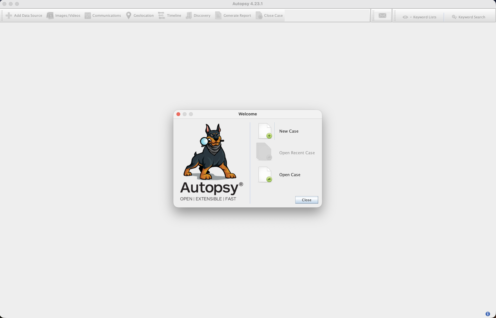
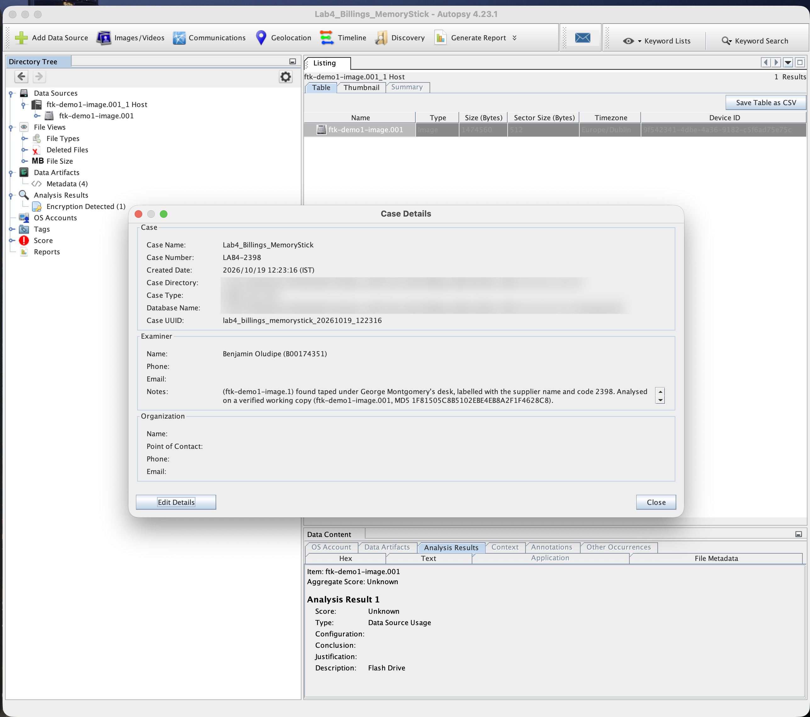
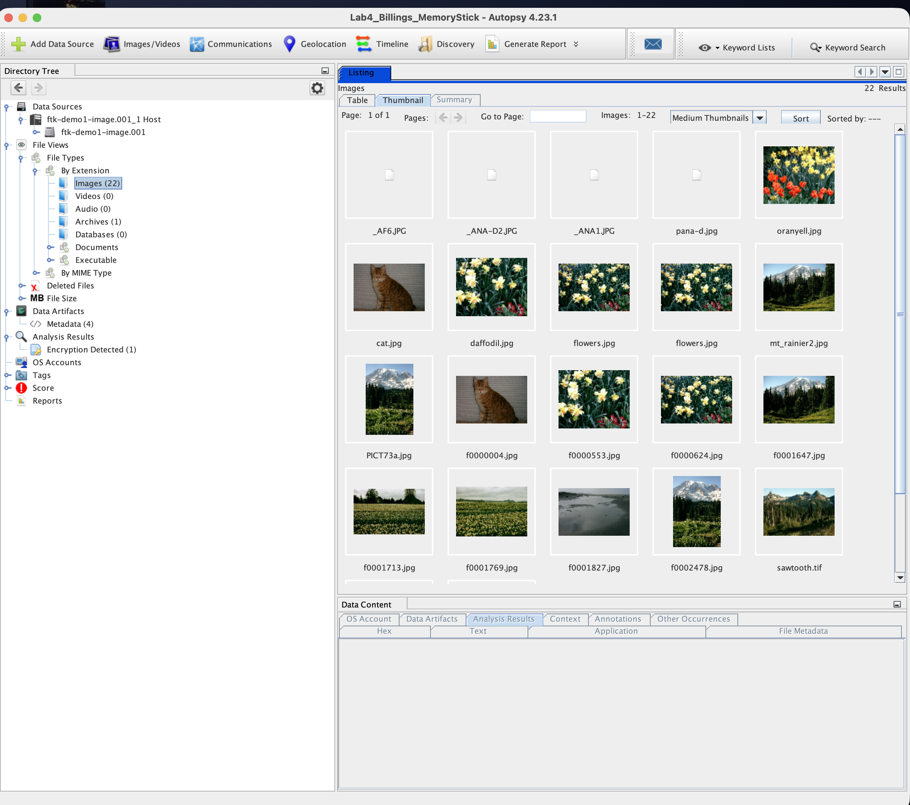
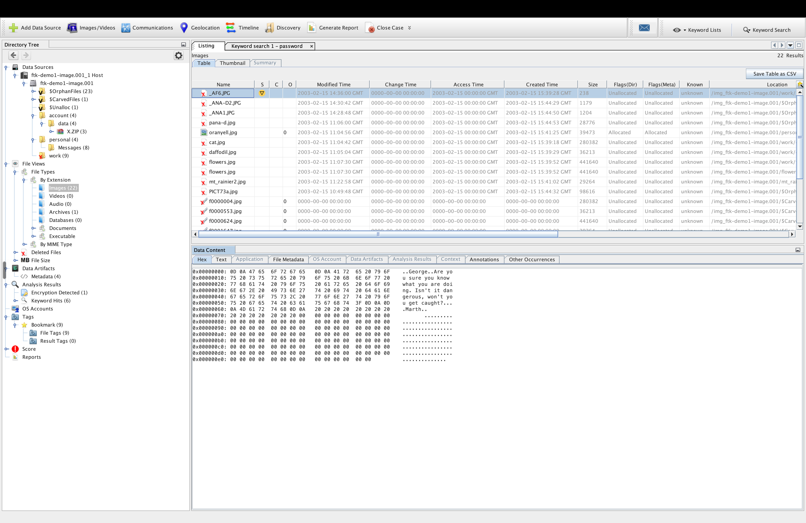
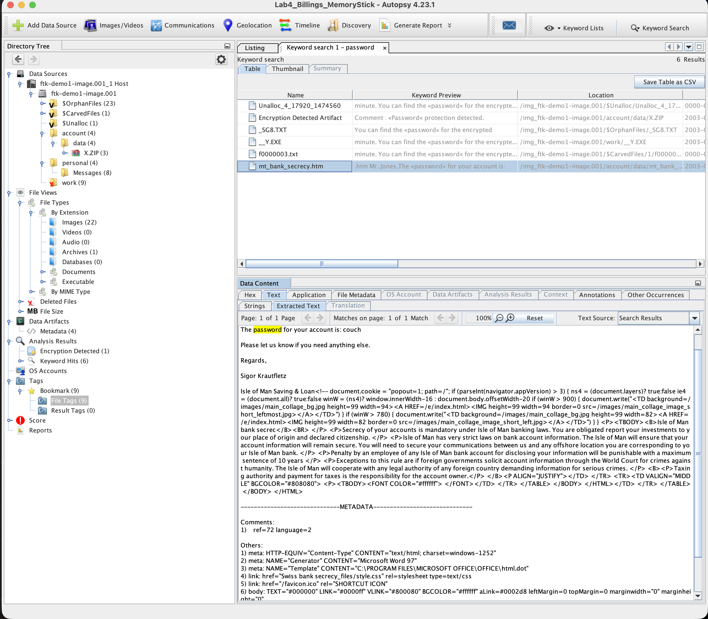

# Digital Forensic Investigation with Autopsy: "Billings" Memory Stick

A full forensic examination of a seized USB memory-stick image in **Autopsy 4.23.1 / The Sleuth Kit 4.15.0**. The work covers evidence integrity, recovery of deleted and disguised files, cracking an encrypted archive, a timeline and a written investigation report.

**Module:** Digital Forensics (COMP-H3011), TU Dublin, Lab 4, individual work
**Examiner:** Benjamin Oludipe
**Tools:** Autopsy, The Sleuth Kit, PhotoRec carver, Apache Solr keyword search, `md5`/`shasum`, `unzip`, Homebrew, Java 17

---

## The case
A 1.44 MB FAT12 image (`ftk-demo1-image.1`) was found taped under a suspect's desk in a fictional embezzlement case. The task: prove the evidence is unaltered, recover what was hidden and report the findings.

## Method
1. **Integrity first:** I verified the supplied MD5 (`1F81505C8B5102EBE4EB8A2F1F4628C8`, which matched) and recorded SHA-1 and SHA-256. I worked only on a hashed working copy, and Autopsy's Data Source Integrity module re-confirmed the same hashes.
2. **Tool build:** Autopsy ships the lab version only as a Windows `.msi`. I installed the latest release on an Apple Silicon Mac, checked its PGP signature, built The Sleuth Kit from source with Java support, and recompiled two libraries for arm64 so the Embedded File Extractor would run.
3. **Ingest:** I configured exactly the ingest modules specified in the lab (hash lookup, file-type ID, extension mismatch, keyword search, encryption detection, PhotoRec carving, and others).
4. **Analysis:** I examined deleted, orphaned and carved files, used hex and strings views, keyword search, tagging and the timeline, then generated the report.

## Key findings
- **Disguised file:** `_AF6.JPG` had no JPEG header (`FF D8 FF`). The hex view showed it was a text message, which proved deliberate hiding of evidence.
- **Encrypted archive:** Encryption Detection flagged `X.ZIP`. A keyword search for "password" recovered a bank e-mail containing the password, which opened the archive. Inside was an offshore bank statement with a final balance of **$3,898,678.00**.
- **Timeline:** the files were copied onto the stick on **15 Feb 2003**.
- Every finding from the earlier FTK Imager lab was confirmed, and Autopsy added carved files and indexed search.

## Evidence
| | |
|---|---|
|  |  |
| Autopsy 4.23.1 built and running on Apple Silicon | Case details: case number, examiner, verified working copy (local paths blurred) |
|  |  |
| Image files in thumbnail view; 4 ".JPG" files show no picture | Hex view of `_AF6.JPG`: no JPEG header, the bytes are a text message |
|  | |
| Keyword search for "password" finds the bank e-mail that unlocks `X.ZIP` | |

The full lab report (19 figures, Q1–Q8, a comparison of Autopsy and FTK, and an Excel report of bookmarked files) is available on request. The evidence image and lab brief belong to the module and are not redistributed.

## What it demonstrates
Chain-of-custody discipline (hash verification and a working copy), file-system forensics on FAT12, deleted-file and carved-data recovery, file-signature analysis, encrypted-container handling, timeline analysis and clear forensic reporting.
